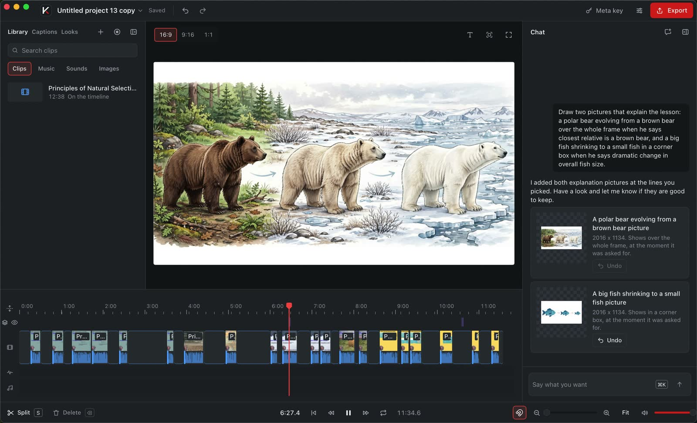
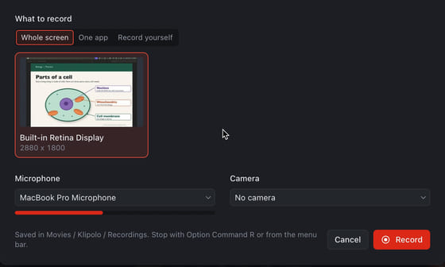
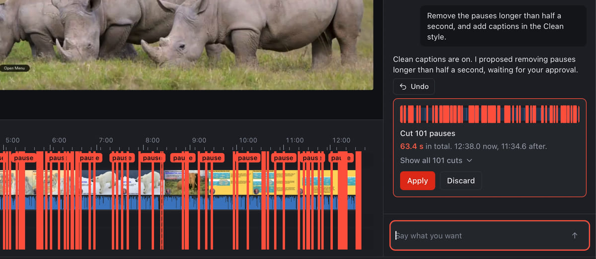
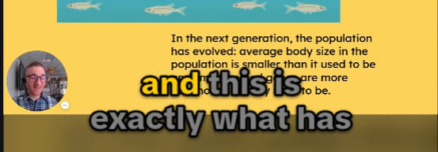
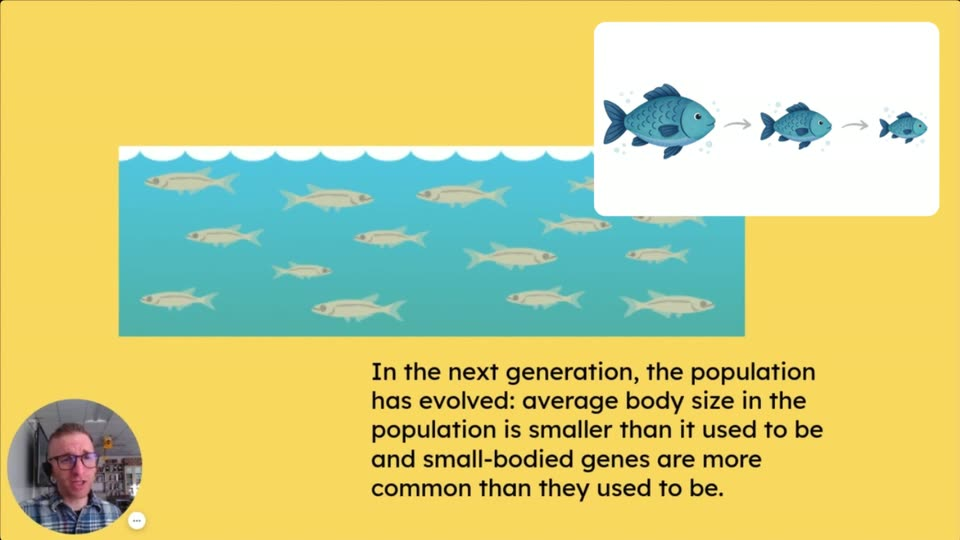
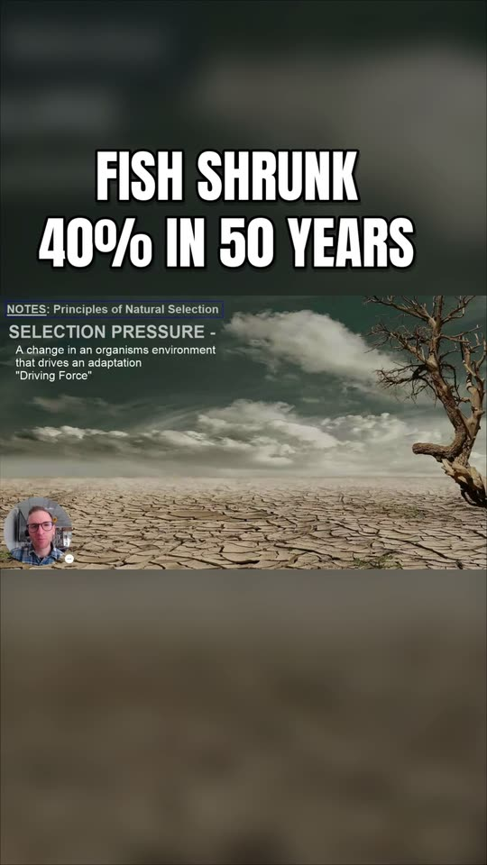
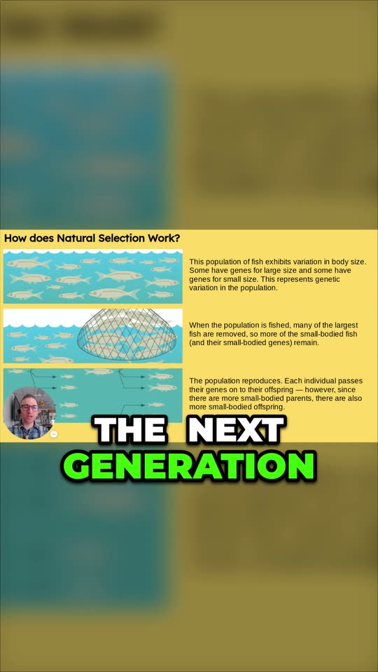
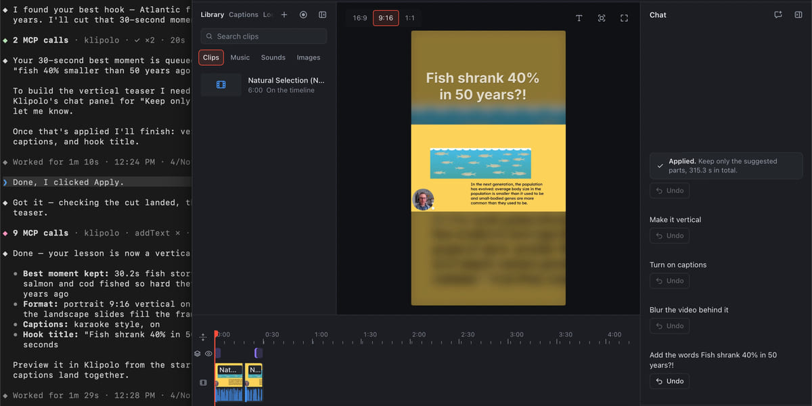

<p align="center">
  
</p>

<h1 align="center">Klipolo</h1>

<p align="center"><b>Record, and edit by typing.</b></p>

<p align="center">
  A Mac video editor you edit by chatting with Meta's models.<br>
  Record your screen or drop in a clip, then ask for the edit in one message.<br>
  Every cut waits in red until you click Apply.
</p>

<p align="center">
  <a href="#install"></a>
  <a href="#install"></a>
  <a href="LICENSE"></a>
  <a href="https://github.com/inventionsbyhamid/klipolo/releases/tag/v0.1.2"></a>
  <a href="#why-rust"></a>
  <a href="#mcp-let-other-apps-edit"></a>
</p>

<p align="center">
  <a href="https://github.com/inventionsbyhamid/klipolo/releases/download/v0.1.2/Klipolo-0.1.2-aarch64.dmg"></a>
  &nbsp;
  <a href="https://github.com/inventionsbyhamid/klipolo/releases/download/v0.1.2/Klipolo-0.1.2-x86_64.dmg"></a>
</p>

<p align="center">
  <a href="https://youtu.be/JAT5tXGfvbs"></a>
</p>

<p align="center">
  
</p>

<p align="center">
  <a href="#what-it-does">What it does</a> ·
  <a href="#how-klipolo-uses-metas-models">Meta's models</a> ·
  <a href="#architecture">Architecture</a> ·
  <a href="#why-rust">Why Rust</a> ·
  <a href="#mcp-let-other-apps-edit">MCP</a> ·
  <a href="#install">Install</a> ·
  <a href="#build-from-source">Build</a> ·
  <a href="#whats-next">What's next</a>
</p>

## Quick start

1. **Download** the disk image for your Mac (buttons above), open it and drag Klipolo to Applications.
2. **Record or import.** Click **Record your screen**, or **New project** and drag in a video. Then click **Analyze**.
3. **Type one message.** For example: "Turn this into a 60 second vertical short with nice animations, sound effects
   and text animations." Click **Apply** on the cut, then **Export**.

Recording, editing and export work offline. Klipolo comes with free AI credit to try the AI features, with no key or
code to type. Add your own Meta API key for more ([Install](#install)).

## What it does

<table>
  <tr>
    <td width="50%" valign="top">
      
      <h3>Record in the app</h3>
      Your whole screen or one app, with your mic and camera, or just yourself on camera. Each source goes to its own
      file, written by a separate recorder process. Clicks get auto zoom, and the
      vertical version follows your cursor.
    </td>
    <td width="50%" valign="top">
      
      <h3>Cut pauses with one message</h3>
      "Remove the pauses longer than half a second, and add captions in the Clean style." Captions apply at once.
      The 101 cuts wait in red, 63.4 s in all, until you click Apply. Pauses are found in the sound itself, and quiet
      stretches where you click are kept.
    </td>
  </tr>
  <tr>
    <td width="50%" valign="top">
      
      
      
      <h3>Captions in seven styles</h3>
      Clean, Bold, Karaoke, Highlight, Boxed, and two made for shorts: Word pop and Bold box. Every word is timed, so
      words light up as they are said. Fix any word by hand, and save an SRT or WebVTT file too.
    </td>
    <td width="50%" valign="top">
      
      <h3>Pictures and stickers by Muse Image</h3>
      Ask for a picture of what you are explaining. It fills the frame for a few seconds, or sits in a corner box away
      from your face, landing on the words you named. Stickers are cut out of their background, and a title card keeps
      your exact words over a drawn background.
    </td>
  </tr>
  <tr>
    <td width="50%" valign="top">
      <p>
        
        
      </p>
      <h3>A 9:16 short that keeps the slide whole</h3>
      One message plans the short: the moments in story order, a hook, captions, stickers, sounds and music. SAM 3.1
      finds the people on screen. When the only one is a small face camera in a corner, the vertical version shows
      the whole slide on a blurred background instead of cropping onto the face.
    </td>
    <td width="50%" valign="top">
      
      <h3>Other apps can edit too (MCP)</h3>
      Klipolo is an MCP server. Any MCP client, such as an AI agent, edits the open project with the same tools chat
      uses, checked by the same compiler. Its additions are one undo step in Klipolo, and its cuts wait for your Apply.
    </td>
  </tr>
</table>

Also in the box: a full editor by hand (split and trim, transitions, speed, keyframes with springs, an effects stack,
roll, slip and slide, freeze frame, reverse, video layers, free fonts and safe areas), motion from plain words ("make
the title glide in from the left with a soft overshoot"), captions in Latin and 11 more scripts, and export of one
MP4 per format (16:9, 9:16 and 1:1) up to Master quality. The same engine draws the preview and the export, so the
file matches what you saw.

<sub>The lesson in these screenshots is <a href="https://www.youtube.com/watch?v=HIrLEGU7Fg8">Principles of Natural
Selection 2021 Google Slides</a> by Nathan Barten, <a href="https://creativecommons.org/licenses/by/3.0/">CC BY
3.0</a>, edited in Klipolo. He does not endorse Klipolo.</sub>

## How Klipolo uses Meta's models

Every model Klipolo calls is a Meta model. It calls no other company's model, and ships none. Each model does one job
it is good at, behind an interface Klipolo owns.

| Model | Its job in Klipolo | What goes in | What comes out | Why this model |
| --- | --- | --- | --- | --- |
| **Muse Spark 1.3**<br>`muse-spark-1.3` | **Chat editing.** Plans the whole edit from one message. | The system prompt, 40 strict function tools, and the project as text: clips, transcript lines with their pauses, the scene log, the media library, the playhead and the selection. Then the message. | Tool calls, up to 10 model calls a message, each with the results of the last. Then a short reply. | Strict function tools and high reasoning effort: in paid test runs it planned a whole short in 3 calls (about $0.08) where Meta's default effort took 10 (about $0.28). |
| **Muse Spark 1.3** | **Scene log.** Watches each imported clip and each Record yourself take. | A 360p, 4 frames a second copy of the clip with its sound, in chunks of at most 10 minutes that overlap by 20 s. | A strict JSON log with times: shots, actions, reactions, text on screen and topic changes. Klipolo snaps it to the hard cuts it finds in every frame. | It takes video and sound together (`input_video`), so it hears a topic change and sees the slide change at once. |
| **Muse Spark 1.3** | **Who is speaking.** | A few seconds of the clip (picture and sound), and where each person SAM 3.1 found is, numbered from the left. | The number of the person whose mouth moves with the voice, or none. | Matching a voice to a face needs sight and sound in one call. |
| **Muse Voice Transcribe**<br>`muse-voice-transcribe-1.0` | **Speech to text.** | A 16 kHz mono WAV of the clip's sound, split at its quietest moment before each 10 minute limit. | Speaker turns, each with a voice label and its text, in the language spoken. | Diarization in one call: whose words are whose, which the crop and the cuts need. |
| **MMS forced aligner**<br>`MMS_FA` | **Word timing.** Runs on CPU on Klipolo's relay. | Each speaker turn's text and its own slice of the WAV (the turn plus 0.25 s on each side). Other scripts are romanized with uroman first. | A start, an end and a score from 0 to 1 for every word. Words it scores near zero (words the transcript invented) are dropped. | Voice Transcribe times turns, not words. MMS is Meta's open aligner for many languages, so captions light up word by word and a cut lands between words. |
| **SAM 3.1**<br>`sam-3.1` | **Finds and follows people.** | A small copy of the footage that plays (854 x 480 at 2 frames a second) and a noun phrase, `person`. | Every match on every frame, as boxes. They become the path of the vertical or square crop. | It finds and tracks every match of a short noun phrase across a whole video in one call, with no training for each video. |
| **Muse Image**<br>`muse-image-1.0` | **Pictures, stickers, title cards.** | A prompt for the subject, with lookups and code tools turned off so a picture costs one image. | A PNG. Klipolo cuts a sticker out of its white background, and a title card's background has no lettering, so your title stays your exact words. | It draws what the speaker is talking about from a short prompt, in one call, for $0.01 a picture. |

Where each one is called:

- Muse Spark chat: `crates/klipolo-analysis/src/providers/meta_chat.rs`, with the tools, prompt and compiler in
  `crates/klipolo-chat`.
- Scene log: `crates/klipolo-analysis/src/providers/meta.rs`, with the small copy in `crates/klipolo-analysis/src/proxy.rs`.
- Who is speaking: `crates/klipolo-analysis/src/providers/meta_voices.rs`.
- Voice Transcribe: `crates/klipolo-meta/src/asr.rs`, called from `crates/klipolo-analysis/src/providers/meta.rs`.
- MMS aligner: `services/relay/relay/align.py`, asked for from `crates/klipolo-meta/src/relay.rs`.
- SAM 3.1: `crates/klipolo-sam` (the request and its per-frame boxes), called from
  `crates/klipolo-analysis/src/providers/meta_sam.rs`.
- Muse Image: `crates/klipolo-meta/src/images.rs`, called from `crates/klipolo-analysis/src/providers/meta_images.rs`,
  with the sticker cut-out in `crates/klipolo-app/src/media/sticker.rs`.
- The MCP demo agent (Muse Spark driving Klipolo over MCP): `scripts/mcp-demo-agent/agent.py`.

All of them go through one client, `crates/klipolo-meta`. With your own key it calls Meta directly; with the free
credit or an access code it goes through Klipolo's relay. Word timing (MMS) runs on the relay either way, which keeps
no audio. Callers never branch on which.

### One message, end to end

This is the message from the screenshot above, on a 12 minute lesson that Klipolo had already analyzed.

<p align="center">
  
</p>

<details>
<summary>Diagram source (Mermaid)</summary>

```text
sequenceDiagram
    actor You
    participant Chat as Chat planner<br/>(klipolo-chat)
    participant Spark as Muse Spark 1.3
    participant Compiler as Compiler<br/>(klipolo-chat)
    participant Timeline as Project and timeline
    You->>Chat: "Remove the pauses longer than half a second,<br/>and add captions in the Clean style."
    Chat->>Spark: system prompt, 40 tools, project context<br/>(transcript, scene log, pauses), message
    Spark-->>Chat: removeSilences (pauses over 0.5 s)<br/>setCaptions (Clean)
    Chat->>Compiler: each call, checked against a snapshot of the project
    Compiler-->>Chat: captions "done", pause cuts "proposed"
    Chat->>Spark: what came of each call
    Spark-->>Chat: closing words, no more calls
    Compiler->>Timeline: captions on: applied at once, one undo step
    Compiler->>Timeline: 101 pause cuts: one proposal, in red
    Chat-->>You: "Clean captions are on. I proposed removing pauses<br/>longer than half a second, waiting for your approval."
    You->>Timeline: Apply: 12:38.0 becomes 11:34.6
```

</details>

1. **The request.** The system prompt, the tools and the project context go first, the same bytes for every message
   on one project revision so Meta's prompt cache reuses them, then the conversation, then your message.
2. **Spark's calls.** Spark answers with tool calls: `removeSilences` for the pauses and `setCaptions` for the style.
   The plan came back in 11.9 s.
3. **The checks.** Each call is read into a typed edit and checked against a snapshot of the project before anything
   changes. Every edge of a cut must sit within 0.3 s of something the model was shown or you said (a word's start
   or end, a pause, a scene item, a clip edge, the selection, the playhead or a time you typed), and it snaps there,
   so a cut never clips a word. A value out of range is refused with the allowed range, never clamped, and the reason
   goes back to Spark to fix on its next step.
4. **The red cut.** Once Spark answers with no more calls, its calls are compiled together. Additions (the captions)
   apply at once as one undo step. Removals become one proposal: "Cut 101
   pauses", 63.4 s in all, 12:38.0 now and 11:34.6 after.
5. **Apply.** Nothing is cut until you click Apply, and Discard drops the proposal. The captions are one step to undo.

The code: the loop is `crates/klipolo-chat/src/planner.rs` (`MAX_STEPS = 10`), the time checks are
`crates/klipolo-chat/src/evidence.rs` (`TOLERANCE_US = 300_000`), the pause cuts are
`crates/klipolo-chat/src/compile/removals.rs`, and the card's words are `crates/klipolo-app/src/chat/describe.rs`.

## Architecture

Klipolo is a Tauri 2 app. Rust crates do the work, a React page draws the editor, and each crate has one job.

<p align="center">
  
</p>

<details>
<summary>Diagram source (Mermaid)</summary>

```text
flowchart TB
    agent["Any MCP client<br/>(an AI agent)"]
    subgraph mac["Klipolo on your Mac"]
        page["Editor page<br/>apps/desktop<br/>React 19 + TypeScript"]
        shell["App shell<br/>klipolo-app<br/>Tauri 2, thin commands"]
        mcp["MCP server<br/>klipolo-mcp"]
        chat["Chat planner + compiler<br/>klipolo-chat"]
        rec["Recorder<br/>klipolo-capture<br/>separate process"]
        engine["Engine<br/>klipolo-engine<br/>wgpu on Metal + FFmpeg"]
        analysis["Analysis<br/>klipolo-analysis<br/>traits + Meta adapters"]
        model["Project model<br/>klipolo-model<br/>ops, validation, undo"]
        metac["Meta client<br/>klipolo-meta"]
    end
    relay["Klipolo relay<br/>services/relay<br/>budgets + MMS aligner"]
    meta["Meta's Model API<br/>Muse Spark, Muse Image<br/>Voice Transcribe, SAM 3.1"]

    page <-->|typed commands and events| shell
    shell --> mcp
    shell --> chat
    shell --> rec
    shell --> engine
    shell --> analysis
    agent <-->|stdio bridge or<br/>HTTP on 127.0.0.1| mcp
    mcp -->|same tools,<br/>same compiler| chat
    chat --> model
    engine --> model
    analysis --> metac
    metac -->|your own key| meta
    metac -->|access code, and<br/>word timing for all| relay
    relay --> meta
```

</details>

### The crates and apps

| Part | What it does | Uses (Klipolo crates) |
| --- | --- | --- |
| `crates/klipolo-model` | The project: types, operations, validation and undo. Pure data and rules, no IO, no platform code. | none |
| `crates/klipolo-chat` | What the model reads about the project, the prompt, the 40 tools, and the compiler that turns calls into checked edits. It talks to a `LanguageModel` trait and names no vendor. | model, cursor |
| `crates/klipolo-engine` | The preview and export engine: a wgpu compositor on the Mac's GPU, with FFmpeg for decode and encode. No Tauri types. | model, cursor, fonts, platform |
| `crates/klipolo-capture` | The recorder: each source to its own crash-safe file, the session state machine and the macOS capture backends. | model, cursor, platform |
| `crates/klipolo-analysis` | The 16 kHz WAV, the small copies, hard cuts, the per-file cache, the transcript, the scene log and the speaker's path. The model services sit behind its traits, with Meta as one adapter. | chat, engine, meta, sam, speech-wire, model, cursor, platform |
| `crates/klipolo-meta` | One HTTP client for Meta's Model API, direct with a key or through the relay. | none |
| `crates/klipolo-sam` | SAM 3.1's wire format: the request for a noun phrase, and per-frame boxes. | none |
| `crates/klipolo-speech-wire` | Word timing rules: where a heard word starts and ends, and each language's hesitations. | model |
| `crates/klipolo-mcp` | The MCP server and its stdio bridge. Reaches the app only through a `Host` trait: no Tauri type, no model vendor, and it never calls a model. | chat, model, platform |
| `crates/klipolo-cursor` | The cursor file a screen take records, its smoothing, and the follow crop planned from it. Pure. | model |
| `crates/klipolo-fonts` | Bundled fonts, the font resolver and fallback chain, and Google's font catalogue. | model, platform |
| `crates/klipolo-platform` | OS services behind one API: a full macOS backend, Windows and Linux stubs, and test fakes. | none |
| `crates/klipolo-app` | The Tauri shell. Its commands are thin: they call into the crates above and wire the Meta adapters in. | all but sam and speech-wire |
| `apps/desktop` | The editor page, React 19 and TypeScript. Its types for Rust's data are generated from the Rust code (ts-rs). | |
| `services/relay` | A small Python service (FastAPI, SQLite) at api.klipolo.com: registers devices, caps each one's spend, forwards only an allowlist of Meta models, and runs the MMS aligner on CPU. | |
| `scripts/mcp-demo-agent` | A small script where Muse Spark edits the open project through Klipolo's MCP tools. | |

### Why it is modular

- **The chat plans, a compiler checks.** Muse Spark edits only through tool calls. The compiler in `klipolo-chat`
  checks each one against a snapshot of the project before anything changes, so Spark can't make an edit the project
  would refuse.
- **One engine, two outputs.** `klipolo-engine` draws the same frames for the preview and the export, so the file is
  what you saw.
- **The MCP server exposes the same tools.** `klipolo-mcp` offers chat's own tools and schemas, minus the two that
  talk to the person in chat, plus four reads; four descriptions are reworded for an app. An agent's calls go through
  the same compiler.
- **Providers behind interfaces.** The analysis owns small traits (`Transcriber`, `Aligner`, `SceneLogger`,
  `SubjectTracker`, `VoiceMatcher`, `ImageMaker`) and chat owns `LanguageModel`. Meta's models sit behind them as
  adapters, so no vendor type reaches the pipeline, the compiler or the page, and tests use fakes of each trait.
- **Built-ins are data.** Caption styles, shader effects, generators and title templates ship as data files
  (`crates/klipolo-model/captions/styles/*.json`, `crates/klipolo-model/presets/*/contrib.json` beside a WGSL
  shader or a scene JSON), so a new one is a data file plus one line that lists it.

## The relay

`services/relay` is Klipolo's own small web service, at api.klipolo.com. It does three jobs:

- **Free credit and access codes.** It holds Klipolo's own Meta key, so people can try the AI features without one.
  The free credit is an access code built into the app, which Klipolo never shows. A device registers once and gets
  a token, and the relay forwards its calls to Meta for an allowlist of models only: Muse Spark, Voice Transcribe,
  Muse Image and SAM 3.1.
- **Word timing for every device.** `POST /v1/align` runs Meta's MMS aligner on CPU for every registered device,
  with your own key or without, up to 120 minutes of audio a device a day.
- **Video for SAM 3.1.** `POST /meta/v1/sam/videos` decodes an upload with ffmpeg and writes the relay's own copy
  (2 frames a second, its long side at most 640, no sound, at most 10 minutes), so it knows how many frames Meta will
  bill before the call goes out.

<p align="center">
  
</p>

<details>
<summary>Diagram source (Mermaid)</summary>

```text
flowchart LR
    app["Klipolo app<br/>free credit, access code<br/>or your own Meta key"]
    subgraph relay["Klipolo relay: FastAPI in one container"]
        devices["Devices<br/>POST /v1/devices<br/>a token, the credit left"]
        align["Word timing<br/>POST /v1/align<br/>MMS aligner on CPU"]
        proxy["Meta proxy<br/>/meta/v1/...<br/>allowlist of Meta models<br/>caps: device, code, total,<br/>SAM a day"]
        sam["Video for SAM<br/>POST /meta/v1/sam/videos<br/>its own 2 fps copy"]
        db[("SQLite<br/>access codes<br/>devices (token hashes)<br/>a ledger row<br/>per charged call")]
    end
    meta["Meta's Model API<br/>Muse Spark, Muse Image<br/>Voice Transcribe, SAM 3.1"]

    app -->|every device registers| devices
    app -->|every device:<br/>speech turns and audio| align
    app -->|free credit or code:<br/>AI calls| proxy
    app -->|free credit or code:<br/>video to track| sam
    app -.->|own key: straight to Meta| meta
    devices --> db
    align -->|minutes used today| db
    proxy -->|reserve, then charge| db
    proxy -->|the relay's own key| meta
    sam -->|upload| meta
```

</details>

**How the money is bounded**

- Before a call goes to Meta, the relay reserves the most it could cost. If the spend leaves no room under a cap, the
  call is refused (402) and never reaches Meta. After Meta answers, the call is charged from Meta's own usage figures,
  and only then is the reservation freed. Failed calls aren't charged.
- The caps: each device (by default $2, all time); each access code, when one is set (what all its devices spend
  together, and how many devices may register with it); the whole relay (by default $40); and SAM 3.1 video tracking,
  a daily cap across every device (by default $5). If Meta ever bills SAM more frames than the relay reserved, SAM is
  turned off for that code.
- Every charged call is a ledger row: the device, the time, the endpoint, the model, Meta's usage figures, the cost
  and the code it came under.

**What it keeps, and what it doesn't**

- One SQLite file: the access codes, the devices (each token only as its SHA-256 hash), which devices registered with
  which code, and the ledger.
- No audio and no video. Word timing's audio waits in a temporary file in memory while the request runs and is
  deleted when it ends. A video for SAM and the relay's copy of it live in a temporary folder that is removed when the
  call ends. Nothing else from a request is stored, and the logs never hold request or response headers, bodies or
  the key.

**The stack.** Python 3.12, FastAPI on uvicorn, httpx to Meta, SQLite in WAL mode, CPU PyTorch 2.8 with torchaudio for
the MMS aligner, uroman for words in other scripts, and ffmpeg for SAM's copies. It runs one worker, because the
limits on calls in flight live in the process. The Docker image pins its base by digest and every package by a lock
file, bakes in the MMS weights so the server downloads nothing at run time, and runs as a user without root. Its fast
tests need no torch and never call Meta.

**How it runs.** One Docker container behind a reverse proxy that ends TLS and limits how fast each client can call.
The container is capped at 8 CPUs and 6 GB, opens no ports of its own, keeps its database on a volume and its
temporary files in memory. An admin command line adds codes, sets a code's cap and device limit, and shows the spend.
`services/relay/README.md` has the routes, the settings and the client contract.

## The website

klipolo.com is the `site/` folder: HTML, CSS and one plain JavaScript module of about 17 KB, written by hand, with no
framework, no dependencies and no build step.

- **Served by nginx** as static files, with gzip, long cache lifetimes for fonts and images, and a strict content
  security policy.
- **Self-hosted media.** The muted loop at the top (a 720p cut for phones) and the full demo film are files on the
  same server; the film is also on YouTube. The loop's first frame is a plain image, so the first paint never waits
  for a video. The loop plays only while it is on screen, and not when the visitor asks for reduced motion or saves
  data, unless they press Play.
- **Images** in AVIF, WebP and JPEG at several widths, and the font (Schibsted Grotesk) self-hosted.
- **Sound, off by default.** A switch turns on keystroke and tick sounds for the typing moments, from one small sprite
  (WebM Opus, with an M4A fallback). With reduced motion on, typing shows its words at once.
- **Lighthouse 12:** performance 100 on desktop and 99 to 100 on mobile, accessibility 96. Measured in headless
  Chromium with simulated throttling, the site served by nginx with its live config, the median of 3 desktop and 5
  mobile runs, on the home page as it was on 4 November, before the demo film moved to the top.

## Why Rust

A video editor spends its life in hot loops: decoding, compositing, timing words, applying edits on long projects.
Klipolo keeps all of that in Rust, on the GPU through wgpu, with FFmpeg linked as a library. The web page only draws
the editor's controls, in the Mac's own WebKit, so no browser engine ships inside the app.

### Our numbers

Measured by us on a 2020 13 inch Intel MacBook Pro (Core i5-1038NG7, Iris Plus graphics, 16 GB, macOS 15), a slow
machine for video work.

| What | Klipolo | How it was measured |
| --- | --- | --- |
| Disk image, 0.1.1 | **43.4 MB** for Apple Silicon (43,424,717 bytes), **46.8 MB** for Intel (46,787,526 bytes) | the released files' sizes |
| Installed app, 0.1.1 | **77.7 MB** for Apple Silicon, **85.5 MB** for Intel: the app binary 35.2 MB and 39.0 MB, FFmpeg's libraries 21.8 MB and 25.7 MB, fonts 6.0 MB, the music, sound and sticker pack 14.4 MB | `du -sk` of each release build's `Klipolo.app` and its parts (75,924 and 83,488 KiB in all) |
| Each edit on a two hour, 3,000 clip project | **under 10 ms** to apply (split 9.2 ms, ripple delete 5.1 ms, roll 3.5 ms, slip 3.3 ms), then 2 to 8 ms for the engine to update | median of 5 runs, a release build of 2 November, on a generated project (`crates/klipolo-engine/examples/perf_harness/long.rs`) |
| Save and open that project | **3.1 ms** to write its JSON (0.95 MB), **6.2 ms** to parse and check it | median of 5 runs, in memory (no disk) |
| A caption frame at 1080p | **about 1 ms** of CPU (0.48 ms for Word pop to 1.06 ms for Highlight, at the median over four styles) and 4.4 to 5.7 ms of GPU | 1,800 frames each, paced at 60 fps |
| Launch until the window shows | **about 3 s** (2.4 to 3.4 s) | one launch, not repeated, the first after installing 0.1.1: the process start time from `ps` (to the second) against the app's own log line when its window showed |
| Memory, idle with a project open | **446 MB** resident in all: the app's process 160.5 MB, the three WebKit processes that started with it 285.8 MB | one reading with `ps -o rss`, 33 minutes after launch, the Mac idle; resident sizes count shared system libraries once in each process, so the real total is lower |

### For scale

Two other open source Mac media apps, from their own release pages: LosslessCut 3.70.2, a video cutter that also
ships FFmpeg, is a 177.9 MB disk image for Intel and 165.8 MB for Apple Silicon
([release](https://github.com/mifi/lossless-cut/releases/tag/v3.70.2)), and Kap 3.6.0, a screen recorder, is 122.7 MB
and 124.7 MB ([release](https://github.com/wulkano/Kap/releases/tag/v3.6.0)). Klipolo's disk image, FFmpeg and its
sound pack included, is about a quarter of LosslessCut's. MB here is 1,000,000 bytes, as the Mac's Finder counts.
GitHub's release pages count 1,048,576 bytes to the MB, so they show those files as 170 MB and 158 MB (LosslessCut)
and 117 MB and 119 MB (Kap), and Klipolo's as 44.6 MB (Intel) and 41.4 MB (Apple Silicon).

## MCP: let other apps edit

Klipolo is an MCP server. Any MCP client can edit the open project with the tools Klipolo's own chat uses, checked by
the same compiler. What adds or restyles applies at once, as one undo step in Klipolo. What removes footage waits in
Klipolo's chat panel until you click Apply. A sticker, picture or title card background waits for your Use.

**1. Turn it on.** In Settings, under **Other apps**, turn on **Let other apps edit with Klipolo**. Klipolo then
listens on 127.0.0.1 only, on a free port, with a new token each run.

**2. Add it to your MCP client.** **Copy config** puts this on the clipboard (the path is your Klipolo's own):

```json
{
  "mcpServers": {
    "klipolo": {
      "command": "/Applications/Klipolo.app/Contents/MacOS/klipolo-app",
      "args": ["--mcp"]
    }
  }
}
```

`klipolo-app --mcp` is a stdio bridge. It answers `initialize` and the tool list by itself, so a client started
before Klipolo still sees every tool, and it passes the rest to the running app.

**3. Ask.** Each line on stdin is one JSON-RPC message. After `initialize`, this cuts the pauses:

```json
{"jsonrpc": "2.0", "id": 2, "method": "tools/call", "params": {"name": "removeSilences", "arguments": {"minPauseSec": 0.5}}}
```

Klipolo answers with a tool result whose text reads like "Proposed in Klipolo (removeSilences): ... s of footage
would go (...). Nothing is cut until the person clicks Apply in Klipolo's chat panel. Call getProposal to see what
they decided."

### The tools

42 tools: 38 of chat's own tools (all but `askUser` and `cannotDo`) and 4 reads. Each schema is strict: closed,
every property required, a value that may be left unsaid is nullable. The list is in `scripts/mcp-demo-agent/tests/fixtures/tools_list.json` and comes from
`crates/klipolo-mcp/src/tools.rs`.

| Group | Tools |
| --- | --- |
| Read | `getSummary`, `getContext`, `getTranscript`, `getProposal` |
| Point at moments | `findMoments` (shows moments to the person, changes nothing) |
| Cut (proposed, waits for Apply) | `cutRange`, `keepOnly`, `removeSilences`, `removeFillers`, `trimClip` |
| Clips | `splitAt`, `freezeFrame`, `setClip`, `setTransition`, `reverseClip`, `setBackground`, `setFormat` |
| Captions | `setCaptions`, `fixCaptionWords` |
| People and the crop | `followSubject` (SAM 3.1), `blurObjects` (answers that blurring is not in Klipolo yet) |
| Media | `addMusic`, `addSound`, `addText`, `addImage` |
| Muse Image | `makeSticker`, `makePicture`, `makeTitleCard` |
| Motion and looks | `animate`, `setMotion`, `animateText`, `setLayer`, `styleText`, `setEffects` |
| Recordings | `setCameraMode`, `adjustCamera`, `detachCamera`, `muteSource`, `setSourceVolume`, `separateSound`, `autoZoom` |
| History | `undo` (only the client's own last change) |

The reads are also resources: `klipolo://project/summary`, `klipolo://context`, `klipolo://transcript` and
`klipolo://proposal`, with transcript pages by time.

### The demo agent

`scripts/mcp-demo-agent/agent.py` is a small script where Muse Spark edits the open project through these tools.
With Klipolo open on an analyzed project and the switch on:

```sh
cd scripts/mcp-demo-agent
python3.12 -m venv .venv
.venv/bin/pip install -r requirements.txt
.venv/bin/python agent.py "In Klipolo, make a 30 second vertical teaser of the best moment, with karaoke captions."
```

It needs your own Meta API key in the `MODEL_API_KEY` environment variable, and sends it only to Meta. It finds
Klipolo in Applications (`--klipolo <path>` for another copy), takes at most 8 model turns, and stops once Muse
Spark's tokens have cost $0.10 (`--max-usd` changes that). Run it again after you click Apply, and it reads what
became of the proposal.

## Install

You need a Mac with Apple Silicon or Intel and macOS 15 or later.

1. **Download** the disk image for your Mac:
   [Klipolo for Apple Silicon](https://github.com/inventionsbyhamid/klipolo/releases/download/v0.1.2/Klipolo-0.1.2-aarch64.dmg)
   (43.4 MB) or [Klipolo for Intel](https://github.com/inventionsbyhamid/klipolo/releases/download/v0.1.2/Klipolo-0.1.2-x86_64.dmg)
   (46.8 MB).
   Not sure which? About This Mac lists a **Chip** on Apple Silicon and an Intel **Processor** on Intel.
2. **Open it and drag Klipolo to Applications.** Both disk images are signed with a Developer ID, notarized by
   Apple and stapled.
3. **Allow Screen Recording** when macOS asks, to record your screen or an app. Klipolo asks for the camera and
   microphone when you first use them.
4. **Try the AI features.** Klipolo comes with free AI credit to try them. There is no key or code to type, and
   Settings (the Settings button at the top right, or Command comma) shows what is left. For more, add your own in
   Settings:
   - **My Meta API key.** Choose My Meta API key, paste your key and click Save key. Klipolo checks it with Meta
     first, then keeps it in your Mac's Keychain. Meta bills your key. Get a key at dev.meta.ai.
   - **Access code.** If you were given one: choose Access code, type the code and click Use code. No Meta account
     needed.

Klipolo shows the price before each analysis, and the clip card shows it before following a speaker. Recording,
editing and export work offline and use no credit. The AI features need the internet.

## Build from source

### Prerequisites

| Tool | Version |
| --- | --- |
| macOS | 15 or later, with the Xcode Command Line Tools |
| Rust | 1.90.0, installed by rustup from `rust-toolchain.toml` (with clippy and rustfmt) |
| Node | 22 |
| pnpm | 11 (`packageManager` is `pnpm@11.15.1`) |
| FFmpeg | Klipolo's own LGPL FFmpeg 9.0.2, built by the script below. Never Homebrew's GPL build. |
| nasm | On an Intel Mac, for FFmpeg's assembly (`brew install nasm`) |

### Steps

1. **FFmpeg.** Build Klipolo's LGPL FFmpeg 9.0.2, or point this checkout at a build you already have:

   ```sh
   scripts/build-ffmpeg.sh                   # this Mac's arch, into .build/ffmpeg-9.0
   scripts/build-ffmpeg.sh --arch arm64      # or the other one
   scripts/link-ffmpeg.sh <build dir>        # or link a shared build
   ```

   `.cargo/config.toml` points at the Intel prefix. On Apple Silicon, point the three FFmpeg variables at the arm64
   prefix:

   ```sh
   export FFMPEG_DIR=$PWD/.build/ffmpeg-9.0/arm64/prefix
   export KLIPOLO_FFMPEG_PREFIX=$FFMPEG_DIR PKG_CONFIG_LIBDIR=$FFMPEG_DIR/lib/pkgconfig
   ```

2. **Run the app.** Install the page's packages and start it:

   ```sh
   pnpm install
   cd apps/desktop
   pnpm tauri dev
   ```

### Tests

`scripts/ci-linux.sh` is the gate: 27 steps that run rustfmt, clippy, the Rust tests, the recorder's kill test, the
engine's GPU tests on a software renderer (Mesa lavapipe), the page's typecheck and tests, and checks that the
generated bindings and the third party notices are current. Run it in the image from `ci/linux.Dockerfile`:

```sh
docker build --platform linux/amd64 -f ci/linux.Dockerfile -t klipolo-ci ci
docker run --rm --platform linux/amd64 -v "$PWD":/src -w /src klipolo-ci scripts/ci-linux.sh
```

The image is x86_64; on an Apple Silicon Mac it runs under emulation and is slow. The gate is heavy: its own header
runs it with --cpus 16 --memory 24g.

The image runs as uid 1000, so the checkout must belong to that user. The repository holds over 6,500 test functions
(about 4,370 in Rust, 1,840 in the page and 400 in Python). Nothing in the gate calls Meta: the Meta client's tests
answer from a local mock server.

### Disk images

`scripts/release/build-mac.sh <x86_64|aarch64> <version>` builds the app (Apple Silicon is cross compiled on an
Intel Mac), checks the bundle (`check-bundle.sh`), signs it (`sign.sh`), notarizes the app and the disk image
(`notarize.sh`) and checks that Gatekeeper accepts it (`check-dmg.sh`). It writes `dist/Klipolo-<version>-<arch>.dmg`
and needs `KLIPOLO_SOURCE_URL`, the public source address that the app's `NOTICE.txt` gives. After any change to
`Cargo.lock` or `pnpm-lock.yaml`, run `scripts/release/third-party.sh` and commit the notices it writes.

### The site

`site/` is klipolo.com: static and hand written, with no build step. Preview it with
`python3 -m http.server -d site`, then open http://localhost:8000. Its two download links are in the
`DOWNLOAD LINKS` comment in `site/index.html`.

### Repo layout

```
apps/desktop/      The editor page (React 19, TypeScript)
crates/            The Rust crates; klipolo-app is the app
services/relay/    Klipolo's relay (Python): budgets, the model allowlist, the MMS aligner
scripts/           FFmpeg, test and release scripts, and the MCP demo agent
assets/            Fonts and the pack of music, sounds, stickers and backgrounds
docs/images/       The screenshots in this README
site/              klipolo.com (static, hand written, no build step)
```

## What's next

- **A plugin system.** Looks, motion presets, audio effects, visual effects, generators and transitions already have
  namespaced ids (`klipolo.builtin/look.warm`), and a project keeps an id it doesn't know untouched. Plugins will add
  their own under their own names.
- **A plugin marketplace.** A place in Klipolo to find, install and update plugins for added features: new tools for
  chat and MCP, new caption styles, new title templates and new effects.
- **Custom effects.** Each built-in shader effect is a `contrib.json` beside a WGSL shader. Your own effects will
  take the same shape, so you can write one, or install one from the marketplace, and keep it in your library.
- **Windows and Linux.** The platform crate already has Windows and Linux backends (stubs that compile and degrade
  honestly), and the Linux gate builds and tests every crate there today. The recorder and the app shell come next.
- **Blur with SAM 3.1.** `blurObjects` is in the tool list and answers that it is coming. It will blur faces, number
  plates or anything else a short phrase names, wherever it shows.
- **Scene logs for screen recordings.** Today a screen recording is analysed for its words only. Imported clips and
  Record yourself takes also get a scene log.
- **Word timing tested in more languages.** Outside English, word timing was tested most on Hindi and Arabic. More
  languages get the same test against reference timings.
- **Updates inside the app.** Klipolo doesn't update itself yet. New versions are on the releases page.

## Licence

- Klipolo is free software under the GNU Affero General Public License, version 3 (`LICENSE`).
- Parts of the video engine and the recorder are derived from other open source code, used under AGPL 3.0 and MIT.
  `crates/klipolo-engine/NOTICE` and `crates/klipolo-capture/NOTICE` name each file and where it came from.
- FFmpeg is used under the LGPL, version 2.1 or later, and is dynamically linked.
- The pack's music, backgrounds and own stickers are made from code by `scripts/gen-library.py` and dedicated to the
  public domain under CC0 1.0. Its sound effects come from Freesound and Kenney under CC0 1.0, and its emoji stickers
  are Google's Noto Emoji under the Apache License 2.0. `assets/library/LICENSE.txt` credits each file, and
  `scripts/library-sources.json` lists where each one came from.
- Each font in `assets/fonts` comes with its own licence file. Schibsted Grotesk, the site font, is under the SIL Open
  Font License (`site/assets/fonts/OFL.txt`); Archivo, which the caption style samples fall back to, is under the SIL
  Open Font License (`apps/desktop/src/styles/fonts/OFL.txt`). The interface uses the Mac's system font.
- The Rust crates and JavaScript packages the app uses are listed with their licences in
  `crates/klipolo-app/licenses/THIRD-PARTY-NOTICES.txt`.
- The relay (`services/relay`) romanizes words in other scripts for word timing with uroman
  (https://github.com/isi-nlp/uroman), under its MIT-style licence: "This project uses the universal romanizer
  software 'uroman' written by Ulf Hermjakob, USC Information Sciences Institute (2015-2020)".
- The relay's word timing uses Meta's MMS forced alignment model (`MMS_FA`, loaded through torchaudio), whose weights
  are under CC BY-NC 4.0. They are downloaded into the relay's image when it is built and are not in this repository.
- The lesson in the screenshots is
  [Principles of Natural Selection 2021 Google Slides](https://www.youtube.com/watch?v=HIrLEGU7Fg8) by Nathan Barten,
  under [CC BY 3.0](https://creativecommons.org/licenses/by/3.0/), edited in Klipolo. The pictures over it were drawn
  by Muse Image in Klipolo. He does not endorse Klipolo.
